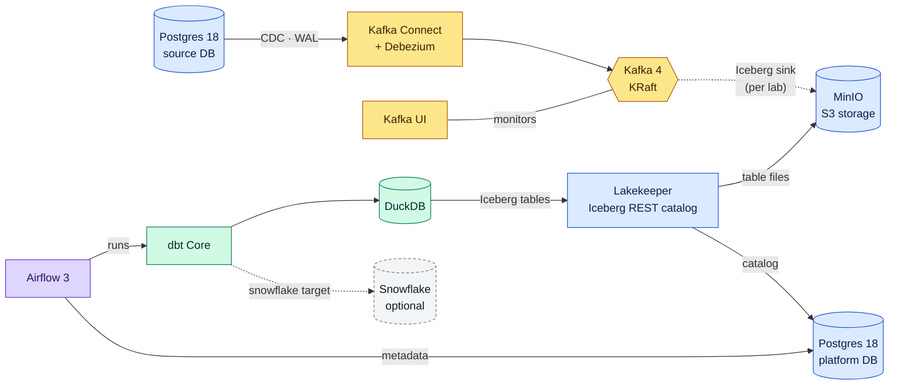

# Data Engineering Lab

A reusable, local **modern data platform** for hands-on labs: change data capture from
Postgres, streaming through Kafka, an Apache Iceberg lakehouse on S3-compatible storage,
orchestration with Airflow 3, and dbt transformations on DuckDB (free, local) or Snowflake
(optional, cloud).

This folder is the **platform only**. It has no pipelines, data generators, DAGs or dbt models
yet. Each lab adds those in [`labs/`](labs/), starting from [`labs/_template/`](labs/_template/README.md).

> **Start here → [RUNBOOK.md](RUNBOOK.md)**: prerequisites, every blank you need to fill in,
> first-time setup, connection checks, daily commands and troubleshooting.

## Architecture



**Colour = compose profile:** 🟦 `core` · 🟨 `streaming` · 🟪 `orchestration` ·
🟩 runs on your laptop (uv) *and* inside Airflow · ⬜ optional cloud. Dashed arrows are wired
but only used once a lab (or you) turns them on.

| Layer | Component | Version | Profile |
|---|---|---|---|
| Source DB | PostgreSQL (logical replication) | 18.7 | core |
| Platform metadata | PostgreSQL (Airflow + Lakekeeper DBs) | 18.7 | core |
| Object storage | MinIO (last community release, see RUNBOOK §8.5) | RELEASE.2025-09-07 | core |
| Lakehouse catalog | Lakekeeper (Apache Iceberg REST catalog) | 0.13.9 | core |
| Streaming | Apache Kafka, KRaft mode (no ZooKeeper) | 4.3.2 | streaming |
| CDC | Kafka Connect + Debezium | 3.6.2.Final | streaming |
| Kafka UI | kafbat/kafka-ui | 1.5.1 | streaming |
| Orchestration | Apache Airflow (LocalExecutor) | 3.4.0 | orchestration |
| Query engine | DuckDB (in-process) | 1.5.6 | — |
| Transformation | dbt Core + dbt-duckdb + dbt-snowflake | 1.12.7 / 1.11.1 / 1.12.5 | — |
| Tooling | uv, ruff, sqlfluff, yamllint, shellcheck, pre-commit | see `pyproject.toml` | — |

## Quick start

```bash
make init            # copy .env.example → .env and dbt/profiles.yml.example → dbt/profiles.yml
```

```bash
make secrets-write   # fill every secret with a strong random value
```

Edit `.env` and replace the remaining `<FILL_ME>` usernames (RUNBOOK §2), then:

```bash
make up              # core profile; or: make up-streaming / make up-orchestration / make up-all
```

```bash
make check           # PASS/FAIL for every service and connection
```

## Layout

```
data-engineering-lab/
├── RUNBOOK.md                 how to set up, run, verify and fix everything
├── docker-compose.yml         all services, grouped into profiles
├── .env.example               every blank, grouped by service (copy to .env)
├── Makefile                   make help lists every command
├── docker/                    init scripts and the custom Airflow image
├── connectors/                Kafka Connect templates (secrets via ${env:…})
├── scripts/                   preflight, wait, check, secrets, connector helpers
├── dags/                      ← lab DAGs go here
├── plugins/                   ← Airflow plugins (if a lab needs one)
├── dbt/                       dbt project skeleton (models/ empty until labs fill it)
├── notebooks/                 ← ad-hoc exploration
├── data/                      local DuckDB file and scratch data (git-ignored)
├── secrets/                   private keys (git-ignored)
└── labs/                      lab write-ups; copy labs/_template to start one
```

Inspired by the shape of
[banking-modern-datastack-2](https://github.com/pawaritpunpao/banking-modern-datastack-2)
(Postgres → Debezium → Kafka → object storage → Airflow → warehouse → dbt). This lab keeps
that shape but updates the stack: KRaft instead of ZooKeeper, an Iceberg lakehouse with a
REST catalog, Airflow 3, DuckDB locally, and no domain-specific code.
