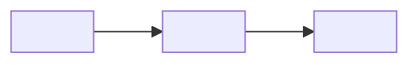

# Lab NN — <title>

> **Profiles:** `core` · `streaming` · `orchestration` *(delete the ones you don't need)*
> **Time:** ~<N> min · **Prerequisites:** <previous lab or "none">

## Goal

<One or two sentences: what you will have built and seen working by the end.>

## Concepts

| Concept | One-line explanation |
|---|---|
| <concept> | <why it matters here> |

## Architecture



## Steps

### 0. Start the platform

```bash
make up PROFILES="core <profile>"
```

```bash
make check
```

### 1. <first step>

<What to do, which file to create (path), and why.>

### 2. <next step>

…

## Check your work

- [ ] <observable result, e.g. "topic `cdc.public.orders` has 10 messages">: `<command>`
- [ ] <query and the expected output>
- [ ] `make check` still passes

## Files touched

| File | Purpose |
|---|---|
| `dags/<file>.py` | <…> |
| `dbt/models/<layer>/<file>.sql` | <…> |

## Stretch goals

1. <harder variation>
2. <scale it / make it fail and recover>
3. <run it against the `snowflake` target>

## Clean up

```bash
make stop PROFILES="<profile>"
```

## Notes & learnings

<What surprised you, what broke, what you'd do differently.>
